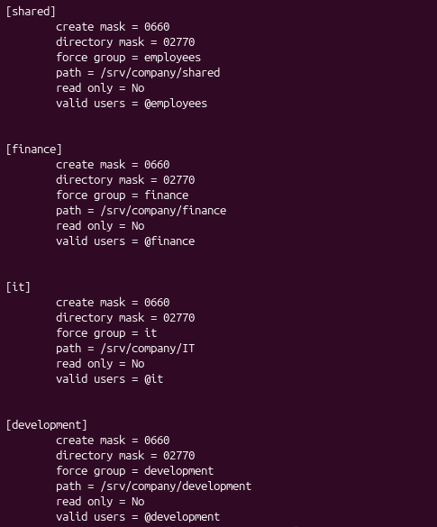
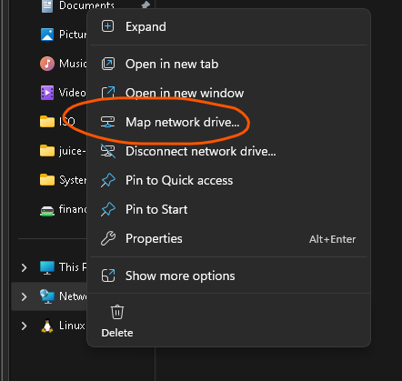
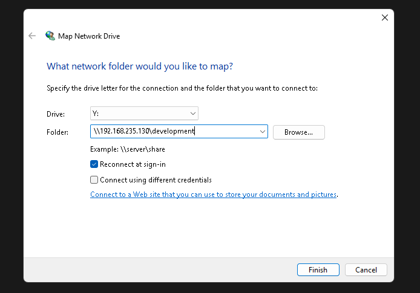

# linux-file-server-backup-automation
Automate Backup on Linux based file server

# Project Overview 
---
This project demonstrates hosting a Linux based file server using `Samba` in a small organization and showcase client-server architecture. Employees are divided into groups. Each group has their own isolated file location for security purposes. The file server is backed up through `cron` (an automation tool) and run `bash` script that create backup archive.

# File System Structure
---
```
srv
└── company
    ├── backups
    ├── development
    ├── finance
    ├── IT
    └── shared
```


# Samba Configuration
---
I added these inside `etc/samba/smb.conf` so that `Samba` can manage who can access the server and which path are allowed.




# Connecting to the Server from Client
---
#### 1. First, we must be connected to the same network as the server 
#### 2. Click on `Map network drive...` as the image displayed



#### 3. Type in the server ip address and the value we set in the `smb.conf`; example : [development] In this format: `\\SERVER.IP\[value]`



#### 4. A login prompt will be displayed. By entering the correct credential, they will be directed to the corresponding file location of user.


# Backup Automation
---
#### A bash script is attached in the repo. 

```shell
tar -czf "$BACKUP_FILE_NAME" \
    -C "$SOURCE" \
    shared finance IT development
```
This create a compressed archive in `tar.gz` format. 

# Scheduling backup using Cron
---
```shell
0 */5 * * * /bin/bash /home/backup.sh >> /var/log/backup.log 2>&1
```
#### The script (backup) will run every 5 hours. My script location is in `/home` but can place anywhere you prefer. The output message of the script will be written in /var/log/backup.log as a history log for backup. 
